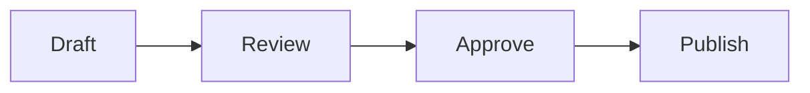

Answer the actual search question in the opening. Write only as much as the reader needs; word count alone is not an SEO quality signal. Keep claims specific, useful, and supported.

## What the reader needs to know

Explain the workflow with facts checked against current product and provider documentation. Link to the most relevant existing [SceneSmith guide](/connections) where it helps the reader. Add `image` and descriptive `imageAlt` frontmatter only when the article has an original image under `public/blog/`.

## How to do it

Give concrete steps, examples, limits, and a way to verify the result. Distinguish platform profiles, pages, plans, and account permissions when their behavior differs. Never claim the ChatGPT plugin is published while its status is pending review.

For a visual tutorial, keep each numbered step short and place its one matching screenshot directly below the step. Give every image useful alt text that describes the visible action; number or label the screenshot callouts to match the steps. Put supplied, approved images in `public/blog/`. If screenshots were not supplied, delete the example image lines and keep the steps as text.

1. **Open the setting you need.** Say where to go and what the reader should see.
   
2. **Choose the destination.** Describe the choice and how to confirm it.
   
3. **Review and finish.** Explain the final check and what success looks like.
   

Add a YouTube clip only when the owner supplies a video link. Replace the example ID with its 11-character YouTube ID; `title` is required. Add optional metadata only when it was supplied or verified from the video itself.

`::video[abcdefghijk]{title="Short descriptive title"}`

An optional chapter start and verified metadata can be added on the same line:

`::video[abcdefghijk]{title="Short descriptive title" start="30" uploaded="2026-10-12" duration="PT4M30S" description="One sentence"}`

Use a Mermaid fenced block only when a diagram makes a workflow easier to understand. Keep labels plain text; HTML, click actions, and configuration directives are rejected.

All media stays in Markdown: no raw HTML, iframe, script, remote screenshot, or hand-written video embed. If no video, screenshot, or diagram was supplied or needed, leave it out.

## Questions readers ask

Add at least three distinct questions when they help readers finish the task or resolve a real limitation. Keep every answer visible here in Markdown and source platform-specific claims below. The site derives FAQ structured data from this section, so do not add questions to JSON-LD that readers cannot see.

### A specific question a reader might ask?

Give a direct answer supported by the article and its sources.

## Sources

Link to the exact primary source used to verify each product or platform claim. Do not paste private Search Console exports, credentials, or raw Hermes reports into this public repository.
